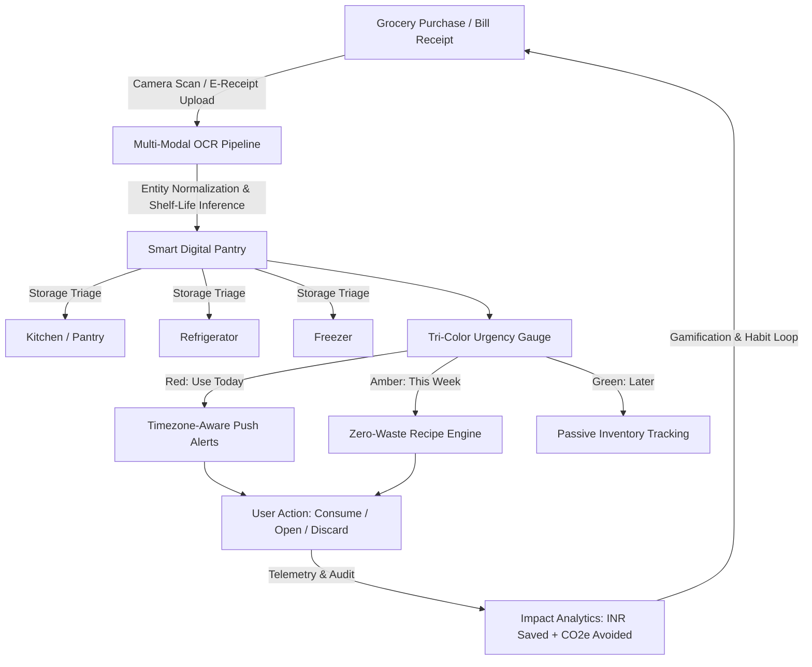
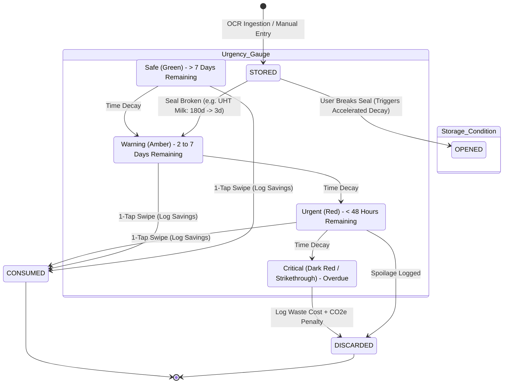
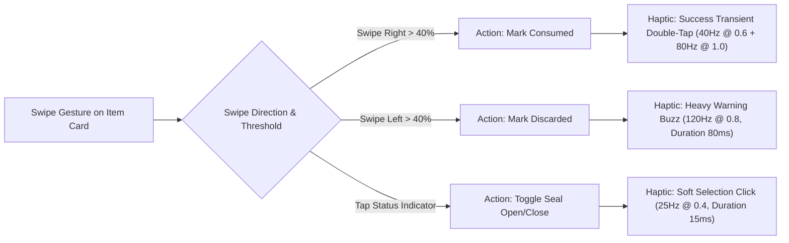
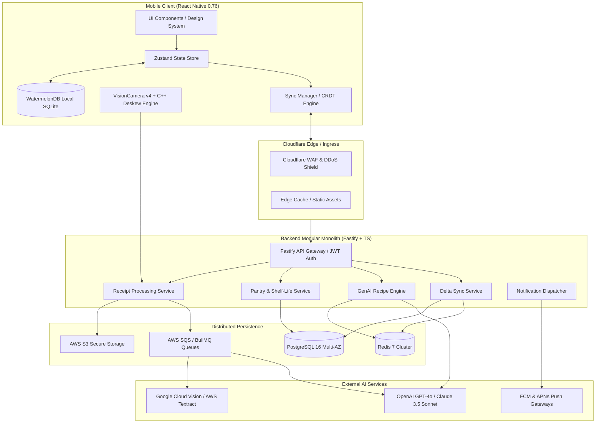
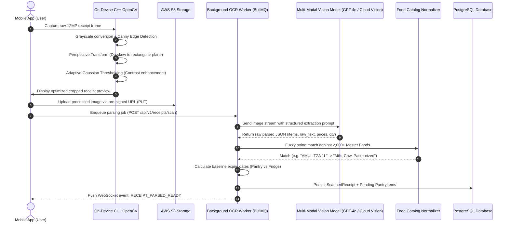
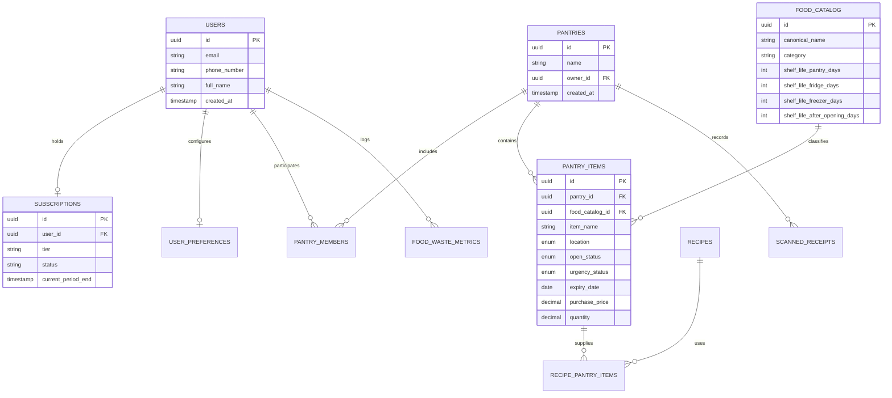
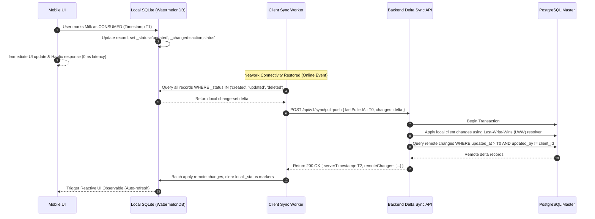
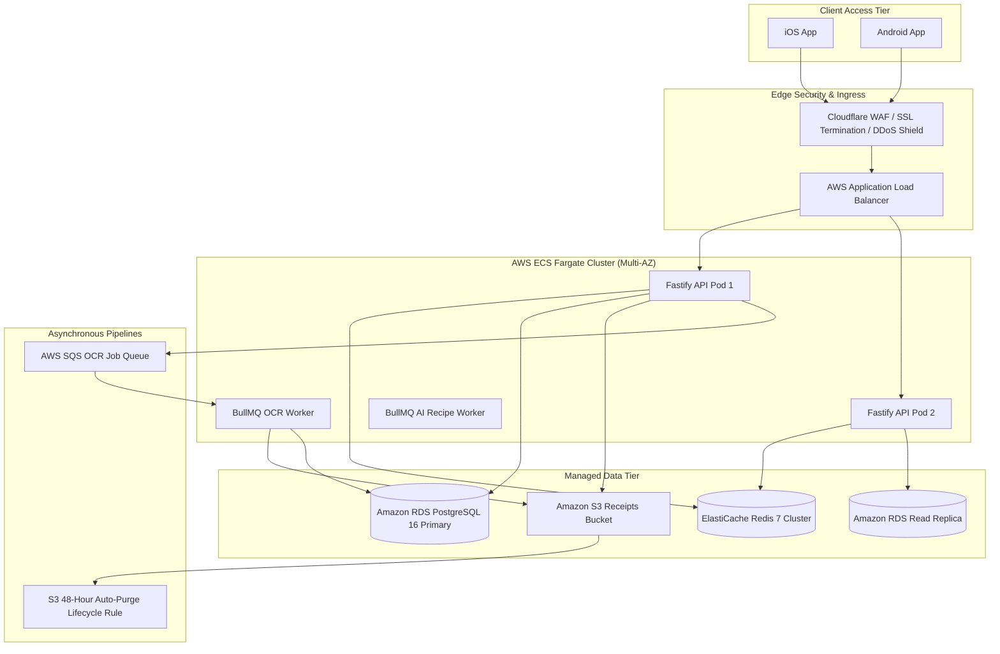
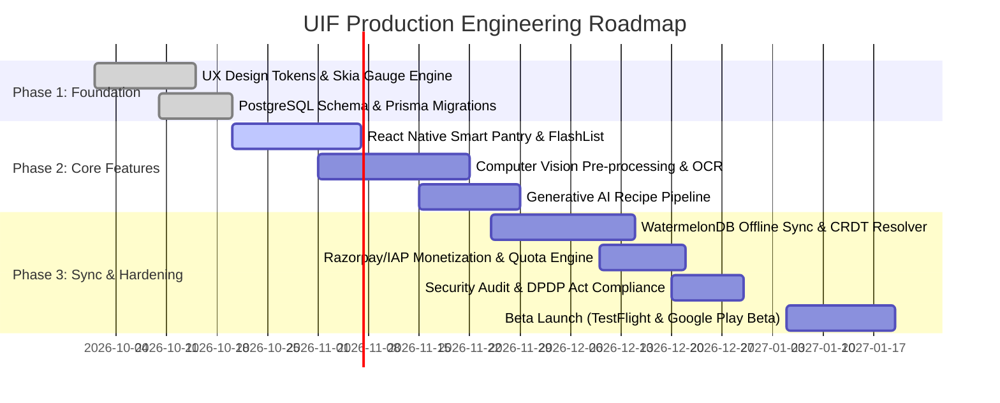

# "Use It First" (UIF) — System Architecture & Production Specification
**Tagline:** *"Save Food. Save Money. Waste Less."*  
**Document Version:** `1.0.0-PROD`  
**Classification:** Enterprise System Architecture & Product Blueprint  
**Target Platforms:** iOS 16.0+, Android 12.0+ (API Level 31+), Cloud Microservices  
**Monetization Matrix:** Tiered Freemium / ₹150/month Premium Subscription  

---

## Table of Contents
1. [Executive Summary & Product Scope](#1-executive-summary--product-scope)
   - 1.1 Mission & Value Loop
   - 1.2 User Personas & Usability Matrix
   - 1.3 Core Food Lifecycle State Machine
2. [UX/UI Design System & Motion Architecture](#2-uxui-design-system--motion-architecture)
   - 2.1 Design Tokens (Color, Elevation, Typography, Radii)
   - 2.2 Tri-Color Speedometer / Gauge Engine (SVG Math & Animation)
   - 2.3 Information Architecture & Screen Wireframe Schemas
   - 2.4 Haptic Engine Specification
   - 2.5 Accessibility Framework (WCAG 2.2 AAA & Elderly Adaptation)
3. [Technology Stack & Architectural Tradeoffs](#3-technology-stack--architectural-tradeoffs)
   - 3.1 Mobile Architecture: React Native vs. Flutter Matrix
   - 3.2 Chosen Mobile Client Architecture (React Native New Architecture)
   - 3.3 Backend Modular Architecture (Node.js/TypeScript Fastify Stack)
   - 3.4 Multi-Modal AI & Receipt OCR Extraction Pipeline
   - 3.5 Generative AI Zero-Waste Recipe Engine
   - 3.6 Timezone-Aware Anti-Fatigue Notification Engine
4. [Complete Relational Database Schema & Data Models](#4-complete-relational-database-schema--data-models)
   - 4.1 ER Diagram (Mermaid)
   - 4.2 Production PostgreSQL DDL (Full Indices, Constraints, Enums, Triggers)
   - 4.3 Shelf-Life & Waste Metrics Mathematical Modeling
5. [API Design & Integration Contracts (OpenAPI 3.0)](#5-api-design--integration-contracts-openapi-30)
   - 5.1 `POST /api/v1/receipts/scan` (Async OCR & WebSocket Pipeline)
   - 5.2 `GET /api/v1/pantry/items` (Filtering, Sorting, Urgency Categorization)
   - 5.3 `POST /api/v1/recipes/generate` (Expiry-Driven Generation Contract)
   - 5.4 `PATCH /api/v1/pantry/items/{id}/triage` (Consume, Open, Discard)
   - 5.5 `GET /api/v1/metrics/impact` (Financial & Environmental ROI)
6. [System Resilience, Offline Synchronization & Cloud Topology](#6-system-resilience-offline-synchronization--cloud-topology)
   - 6.1 Offline-First CRDT / Change-Log Sync Protocol (WatermelonDB ⇄ PostgreSQL)
   - 6.2 Tiered Monetization & Feature-Gating Engine (₹150/mo Premium vs. Free)
   - 6.3 Scalable Cloud Infrastructure Topology (AWS ECS Fargate, S3 Auto-Purge, Redis)
   - 6.4 Security, Data Privacy & Regulatory Compliance (DPDP Act 2023, GDPR)

---

# 1. Executive Summary & Product Scope

### 1.1 Mission & Value Loop
Food waste represents an annual global economic drag exceeding $1 trillion and accounts for 8–10% of total anthropogenic greenhouse gas emissions. At the domestic level, households in urban environments discard 25% to 35% of purchased groceries due to information asymmetry, lack of visibility into pantry contents, opaque expiry dates, and fragmented meal planning.

**"Use It First" (UIF)** is an intelligent post-purchase food lifecycle operating system. By integrating edge-accelerated computer vision (receipt scanning), a dynamic tri-color shelf-life gauge, and a constrained Generative AI culinary pipeline, UIF converts household groceries into timely meals before perishability occurs.



---

### 1.2 User Personas & Usability Matrix

| Dimension | Persona 1: Busy Family ("The Sharmas") | Persona 2: Working Professional ("Rohan", 28) | Persona 3: Budget Student ("Ananya", 21) | Persona 4: Senior Citizen ("Col. Verma", 72) |
| :--- | :--- | :--- | :--- | :--- |
| **Primary Motivation** | Stop wasting bulk-bought groceries; feed 4+ with diverse tastes. | Maximize convenience; avoid smelly fridge surprises after 14-hr shifts. | Stretch tight monthly budget; track exact rupee savings. | Simple reminder of expiry; large readable text; zero friction. |
| **Pantry Scale** | 80–150 active SKUs across Pantry, Fridge, Deep Freezer. | 15–30 active SKUs (quick meal kits, dairy, fruits, veggies). | 10–25 active SKUs (staples, lentils, eggs, bread, milk). | 20–40 traditional staples and daily fresh dairy/vegetables. |
| **Input Modality** | Supermarket thermal bill batch OCR scan; multi-member updates. | Instant digital invoice forward (Blinkit/Zepto/Instamart) & OCR. | Manual quick-add barcode scanner + thermal slip OCR. | Voice input ("Added 1 liter milk") and high-contrast large buttons. |
| **Notification Window** | 07:30 AM (daily meal planner) & 05:00 PM (dinner prep). | 06:15 PM (metro commute heading home). | 08:00 PM (hostel/flat dinner prep). | 10:30 AM (post-morning walk domestic check). |
| **Key UX Constraint** | Real-time multi-device sync without race conditions. | 1-tap triage (< 2 seconds per item). | Explicit cost attribution per discarded item. | WCAG 2.2 AAA, ≥48dp touch targets, high contrast, no gesture-only traps. |

---

### 1.3 Core Food Lifecycle State Machine

Each food item tracks two orthogonal vectors: **Perishability Status** (chronological decay) and **Physical State** (storage & seal integrity).



---

# 2. UX/UI Design System & Motion Architecture

### 2.1 Design Tokens (Color, Elevation, Typography, Radii)

The brand identity centers on nature, kitchen freshness, and urgent visual cues. The primary palette uses **Emerald & Forest Green**, balanced with strict WCAG-tested semantic alert tones.

#### Color Tokens
```json
{
  "color": {
    "brand": {
      "primary-50": "#E6F7F0",
      "primary-100": "#C2EEDC",
      "primary-200": "#99E3C5",
      "primary-500": "#10B981",
      "primary-600": "#0D7A57",
      "primary-700": "#0A5C41",
      "primary-800": "#064E3B",
      "primary-900": "#022C22"
    },
    "urgency": {
      "safe-green": {
        "light": "#059669",
        "dark": "#10B981",
        "surface-light": "#ECFDF5",
        "surface-dark": "#064E3B33",
        "contrast-ratio": "4.8:1"
      },
      "warning-amber": {
        "light": "#D97706",
        "dark": "#F59E0B",
        "surface-light": "#FFFBEB",
        "surface-dark": "#78350F33",
        "contrast-ratio": "4.6:1"
      },
      "urgent-red": {
        "light": "#DC2626",
        "dark": "#EF4444",
        "surface-light": "#FEF2F2",
        "surface-dark": "#7F1D1D33",
        "contrast-ratio": "5.1:1"
      }
    },
    "surface": {
      "light-bg": "#F8FAFC",
      "light-card": "#FFFFFF",
      "light-card-elevated": "#F1F5F9",
      "dark-bg": "#0B1310",
      "dark-card": "#13211C",
      "dark-card-elevated": "#1A2E27"
    },
    "text": {
      "light-primary": "#0F172A",
      "light-secondary": "#475569",
      "light-tertiary": "#94A3B8",
      "dark-primary": "#F8FAFC",
      "dark-secondary": "#CBD5E1",
      "dark-tertiary": "#64748B"
    }
  }
}
```

#### Typography System
UIF integrates a dual-font scale: **Plus Jakarta Sans** (headings, bold badges, numbers) and **Inter** (body, tabular expiry dates, receipt parsing details).

| Token Name | Size (pt/dp) | Line Height | Weight | Scaled Font Category (iOS / Android) |
| :--- | :--- | :--- | :--- | :--- |
| `display-large` | 34 | 40 | 800 (Extrabold) | Large Title / Display Large |
| `headline-1` | 28 | 34 | 700 (Bold) | Title 1 / Headline Medium |
| `headline-2` | 22 | 28 | 700 (Bold) | Title 2 / Headline Small |
| `title-medium` | 18 | 24 | 600 (Semibold) | Headline / Title Medium |
| `body-large` | 16 | 24 | 400 (Regular) | Body / Body Large |
| `body-medium` | 14 | 20 | 400 / 500 (Medium)| Subhead / Body Medium |
| `tabular-stat` | 15 | 20 | 700 (Mono Digits)| Callout (tnum) / Label Large |
| `caption-bold` | 12 | 16 | 700 (Semibold) | Caption 1 / Label Small |

---

### 2.2 Tri-Color Speedometer / Gauge Engine (SVG Math & Animation)

The core visual anchor of UIF is the **Perishability Gauge**: a circular speedometer arc displaying the percentage of total pantry items across the three safety bands, with a dynamic needle indicating the aggregate Household Expiry Risk Score ($0 = \text{All Expired}, 100 = \text{All Fresh}$).

```
             Household Food Health Gauge
                      180° Arc
                  . - ~ ~ ~ - .
              . '   [ Amber ]   ' .
          . '  [Red]           [Green]' .
        .  (Use Today)           (Safe)   .
       .                                   .
      |                  /                  |
      |                 / (Dynamic Needle)  |
      + - - - - - - - - o - - - - - - - - - +
                 Current Score: 78
            "Safe - 4 Items Need Attention"
```

#### SVG Geometry & Mathematical Formulas
For an arc of radius $R = 80$, center $(cx, cy) = (100, 100)$, stroke width $W = 12$, and sweeping angle $\theta = 180^\circ$ ($\pi$ radians):

$$\text{Circumference}_{\text{semi}} = \pi \times R \approx 3.14159 \times 80 = 251.327 \text{ px}$$

Let $P_{\text{red}}$, $P_{\text{amber}}$, and $P_{\text{green}}$ be the proportions of items expiring in $\le 2\text{ days}$, $3\text{--}7\text{ days}$, and $>7\text{ days}$:

$$\text{dashoffset}_{\text{segment}} = \text{Circumference}_{\text{semi}} \times \left(1 - \sum P_i\right)$$

#### Production React Native Skia / SVG Gauge Implementation
```tsx
import React, { useEffect } from 'react';
import { View, StyleSheet, Text } from 'react-native';
import Svg, { Path, G, Circle, Line } from 'react-native-svg';
import Animated, {
  useSharedValue,
  useAnimatedProps,
  withSpring,
  interpolate,
} from 'react-native-reanimated';

const AnimatedLine = Animated.createAnimatedComponent(Line);
const AnimatedCircle = Animated.createAnimatedComponent(Circle);

interface SpeedometerProps {
  score: number; // 0 (Critical) to 100 (Optimal)
  redRatio: number;   // e.g. 0.20
  amberRatio: number; // e.g. 0.30
  greenRatio: number; // e.g. 0.50
}

export const UIFSpeedometerGauge: React.FC<SpeedometerProps> = ({
  score,
  redRatio,
  amberRatio,
  greenRatio,
}) => {
  const animatedScore = useSharedValue(0);

  useEffect(() => {
    animatedScore.value = withSpring(score, {
      damping: 15,
      stiffness: 90,
      mass: 1,
    });
  }, [score]);

  // Radius = 80, cx = 100, cy = 100
  // Arc path from (-80, 0) to (80, 0) through (0, -80)
  // Total arc length = Math.PI * 80 = 251.327
  const arcLength = Math.PI * 80;

  const needleAnimatedProps = useAnimatedProps(() => {
    // Score 0 -> Angle 180 deg (Left / Red)
    // Score 100 -> Angle 0 deg (Right / Green)
    const angleDeg = interpolate(animatedScore.value, [0, 100], [180, 0]);
    const angleRad = (angleDeg * Math.PI) / 180;
    const needleLength = 65;
    const x2 = 100 + needleLength * Math.cos(angleRad);
    const y2 = 100 - needleLength * Math.sin(angleRad);

    return {
      x2,
      y2,
    };
  });

  return (
    <View style={styles.container}>
      <Svg width={200} height={120} viewBox="0 0 200 120">
        <G strokeWidth={14} fill="none" strokeLinecap="round">
          {/* Base Red Zone (0 to 180 deg) */}
          <Path
            d="M 20 100 A 80 80 0 0 1 180 100"
            stroke="#EF4444"
            strokeDasharray={`${arcLength} ${arcLength}`}
            strokeDashoffset={0}
          />
          {/* Amber Segment Overlay */}
          <Path
            d="M 20 100 A 80 80 0 0 1 180 100"
            stroke="#F59E0B"
            strokeDasharray={`${arcLength} ${arcLength}`}
            strokeDashoffset={arcLength * redRatio}
          />
          {/* Green Segment Overlay */}
          <Path
            d="M 20 100 A 80 80 0 0 1 180 100"
            stroke="#10B981"
            strokeDasharray={`${arcLength} ${arcLength}`}
            strokeDashoffset={arcLength * (redRatio + amberRatio)}
          />
        </G>

        {/* Dynamic Needle */}
        <AnimatedLine
          x1={100}
          y1={100}
          animatedProps={needleAnimatedProps}
          stroke="#0F172A"
          strokeWidth={3.5}
          strokeLinecap="round"
        />
        <Circle cx={100} cy={100} r={6} fill="#0F172A" />
        <Circle cx={100} cy={100} r={2.5} fill="#FFFFFF" />
      </Svg>
      <Text style={styles.scoreText}>{Math.round(score)}/100</Text>
      <Text style={styles.labelSub}>Household Freshness Score</Text>
    </View>
  );
};

const styles = StyleSheet.create({
  container: { alignItems: 'center', marginVertical: 12 },
  scoreText: { fontSize: 24, fontWeight: '800', color: '#0F172A', marginTop: -15 },
  labelSub: { fontSize: 12, fontWeight: '500', color: '#64748B' },
});
```

---

### 2.3 Information Architecture & Screen Wireframe Schemas

```
================================================================================
SCREEN 1: SMART PANTRY (DASHBOARD)
================================================================================
[ Top App Bar: Household Selector ▼ | Notifications 🔔 | Profile 👤 ]
--------------------------------------------------------------------------------
[ SPEEDOMETER CARD: Freshness Score (78/100) | 3 Expiring Today | 5 This Week ]
--------------------------------------------------------------------------------
[ LOCATION FILTER PILLS: (● All) | (❄️ Fridge: 14) | (🧊 Freezer: 8) | (🧺 Pantry: 22) ]
--------------------------------------------------------------------------------
[ TAB BAR: [ ALL (44) ]  [ STORED (32) ]  [ OPENED (9) ]  [ EXPIRED (3) ] ]
--------------------------------------------------------------------------------
[ SEARCH & SORT: 🔍 Search ingredients...          [ ↕️ Sort: Urgency First ▼ ] ]
--------------------------------------------------------------------------------
[ ITEM CARDS (Virtualised FlashList)                                            ]
| 🔴 [Milk (Amul Taaza 1L)]      | Open 2d ago | USE TODAY   | [✓ Cook] [✕ Dump] |
| 🔴 [Paneer 200g]              | Unopened    | 1 Day Left  | [✓ Cook] [✕ Dump] |
| 🟡 [Spinach Bundle]           | Fridge      | 4 Days Left | [✓ Cook] [✕ Dump] |
| 🟢 [Basmati Rice 5kg]         | Pantry      | 180 Days    | [✓ Cook] [✕ Dump] |
--------------------------------------------------------------------------------
[ FLOATING ACTION BUTTON: [ 📷 Scan Receipt / Add Item + ]                     ]
[ BOTTOM NAV: [ 🍱 Pantry ]  [ 🍳 AI Chef ]  [ 📊 Savings ]  [ ⚙️ Settings ]  ]
================================================================================

================================================================================
SCREEN 2: RECEIPT SCANNING & REVIEW FLOW
================================================================================
[ Top Bar: [ < Back ]               Scan Supermarket Bill               [ ⚡ Torch ] ]
--------------------------------------------------------------------------------
[ CAMERA VIEWFINDER (Live Bounding Boxes overlaying bill line items)           ]
|  ┌────────────────────────────────────────────────────────┐                  |
|  │ [Green Bounding Box: 1x Amul Butter 500g ...... ₹275 ] │                  |
|  │ [Green Bounding Box: 2x Greek Yogurt 100g ..... ₹120 ] │                  |
|  │ [Amber Bounding Box: 1x Organic Bananas 1kg ... ₹60  ] │                  |
|  └────────────────────────────────────────────────────────┘                  |
|  Scanning status: "Parsed 12 items with 98% accuracy..."                     |
--------------------------------------------------------------------------------
[ BOTTOM SHEET DRAWER (Review & Confirm Parsed Items):                         ]
|  [x] Amul Butter 500g   -> Loc: [Fridge  ▼] Shelf Life: [120 Days] (₹275)    |
|  [x] Greek Yogurt 100g  -> Loc: [Fridge  ▼] Shelf Life: [14 Days]  (₹120)    |
|  [x] Bananas (Ripe)     -> Loc: [Pantry  ▼] Shelf Life: [3 Days]   (₹60)     |
|------------------------------------------------------------------------------|
| [ + Add Missing Item ]                 [ CONFIRM & IMPORT 12 ITEMS (₹455) ➔ ]|
================================================================================

================================================================================
SCREEN 3: EXPIRY-DRIVEN AI RECIPE GENERATOR
================================================================================
[ Top Bar: [ < Back ]             Zero-Waste Kitchen AI             [ Filter ⚙️ ] ]
--------------------------------------------------------------------------------
[ URGENT INGREDIENTS AUTO-SELECTED:                                             ]
|  [x] 🥛 Milk (Expires Today)  [x] 🧀 Paneer (1 Day)  [x] 🥬 Spinach (4 Days)   |
|  + Select extra pantry staples: [x] Onion  [x] Garlic  [x] Cumin Seeds        |
--------------------------------------------------------------------------------
[ PREFERENCES: Meal: [Dinner ▼] | Time: [< 25 Mins ▼] | Diet: [Vegetarian ▼]    ]
--------------------------------------------------------------------------------
[ BUTTON: [ ✨ Generate Waste-Elimination Recipes (Uses 3 Urgent Items) ]       ]
--------------------------------------------------------------------------------
[ AI RECIPE RECOMMENDATION CARD:                                                ]
|  "Quick Palak Paneer with Spiced Warm Milk Dessert"                          |
|  ★ 94% Waste Rescue Score | ⏱️ 20 mins | 🔥 380 kcal | Saves ₹185 Food Waste  |
|  Ingredients Matched: 3/3 Urgent Items Consumed!                              |
|  Step 1: Blanch spinach for 2 minutes...                                     |
|  Step 2: Cube paneer and lightly sauté...                                    |
|------------------------------------------------------------------------------|
| [ 🧑‍🍳 START STEP-BY-STEP COOKING MODE ]  [ MARK INGREDIENTS CONSUMED (1-TAP) ]|
================================================================================
```

---

### 2.4 Haptic Engine Specification
UIF uses physical tactile feedback through Apple CoreHaptics (`CHHapticEngine`) and Android Vibrator Engine (`VibrationEffect`) to reinforce deliberate food management actions.



---

### 2.5 Accessibility Framework (WCAG 2.2 AAA & Senior Adaptation)
To support elderly users (Persona 4: "Col. Verma", 72) and visually impaired individuals:
1. **Dynamic Font Scaling:** Full support for iOS Dynamic Type (`UIFontMetrics`) and Android `sp` units, allowing text to scale up to 200% without clipping or layout overflow.
2. **Touch Targets:** All interactive triggers (Triage checkboxes, Swipe buttons, Category selectors) possess a minimum bounding box of **$48 \times 48\text{ dp}$**.
3. **Multi-Sensory Signifiers:** Urgency is never communicated by color alone. Every urgency badge presents:
   - Visual color indicator (Red / Amber / Green).
   - Text label ("Use Today", "This Week", "Safe").
   - Semantic icon (Clock ⏱️ for Today, Exclamation ⚠️ for This Week, Shield 🛡️ for Safe).
   - Screen-reader announcement (`accessibilityLabel="Paneer 200 grams, expires in 24 hours, urgent priority"`).
4. **Voice Entry:** Native speech-to-text integration on search and quick-add fields.

---

# 3. Technology Stack & Architectural Tradeoffs

### 3.1 Mobile Architecture: React Native vs. Flutter Matrix

| Criterion | React Native (0.76+ New Architecture) | Flutter 3.24+ (Impeller Engine) | Architectural Decision & Justification |
| :--- | :--- | :--- | :--- |
| **Rendering Performance** | 60/120 FPS via Fabric renderer & C++ JSI bindings. Shopify FlashList virtualizes 1,000+ items with zero frame drops. | 120 FPS guaranteed via Impeller Vulkan/Metal engine. Zero jank on complex transforms. | **Tie.** Both frameworks meet the 120 FPS standard for list rendering. |
| **Camera & Document OCR** | Direct C++ access to OpenCV/CoreImage via Nitro Modules / TurboModules. Native VisionCamera v4 handles 4K frame buffer streaming. | Camera plugin requires platform channels with memory buffer copying across the Dart-C++ bridge. | **Winner: React Native.** Direct zero-copy memory access to frame buffers for real-time receipt edge detection. |
| **Offline SQLite & CRDT** | WatermelonDB / Expo SQLite / OP-SQLite leverages SQLite in C++ via JSI with multi-threaded queries. | drift / Hive / Isar offer native Dart performance. | **Winner: React Native.** WatermelonDB's lazy loading model is optimized for resource-constrained phones. |
| **Ecosystem & AI SDKs** | First-party TypeScript definitions for Google Cloud, OpenAI, Supabase, and AWS Amplify. | Strong Dart packages, but cutting-edge AI streaming APIs frequently lag TypeScript releases. | **Winner: React Native.** Direct code sharing between mobile and Node.js backend. |

**Final Decision:** **React Native 0.76+** with TurboModules, Fabric, React Native Reanimated 3, React Native Skia, and TypeScript.

---

### 3.2 System Architecture Overview



---

### 3.3 Receipt Processing Pipeline (Computer Vision & OCR)

Thermal receipts from modern supermarkets present major challenges: crumpling, low-contrast ink fading, skewed angles, and non-standard line layouts. UIF uses a 3-tier pipeline:



---

### 3.4 Generative AI Zero-Waste Recipe Engine

The Recipe Engine converts items flagged as `USE_TODAY` and `THIS_WEEK` into complete, balanced culinary plans.

#### Guardrail Architecture
1. **Pantry Primacy:** The prompt injects the list of expiring items as *mandatory core components*.
2. **Deterministic Response Schema:** OpenAI Structured Outputs (`json_schema` mode) enforce strict typing.
3. **Allergen & Dietary Isolation:** Hard user constraints (e.g., Vegan, Nut Allergy, Halal) are injected as immutable system instructions.
4. **Hallucination Prevention:** The model is prohibited from inventing rare ingredients; extra required items are limited to basic household staples (salt, pepper, oil, water).

#### System Prompt Template
```markdown
You are the UIF Zero-Waste Master Chef Engine. Your primary mission is to eradicate domestic food waste by designing appetizing, safe, and practical recipes based strictly on items nearing expiry.

STRICT OPERATIONAL RULES:
1. You MUST utilize at least 80% of the ingredients listed in the `URGENT_ITEMS` array.
2. You MAY supplement ONLY with common household essentials: Salt, Black Pepper, Cooking Oil, Water, Sugar, Basic Spices (Turmeric, Cumin, Chili Powder, Garlic, Onion).
3. Adhere strictly to the user's dietary flags: {{USER_DIETARY_PREFERENCES}} and allergen exclusions: {{USER_ALLERGENS}}.
4. Return ONLY valid JSON adhering to the specified RecipeOutput schema. No conversational filler.
```

---

### 3.5 Timezone-Aware Anti-Fatigue Notification Engine

Notification fatigue is the #1 driver of app uninstalls. UIF executes push notifications through a **Local Timezone-Aware Batching Window**:

1. **Daily Digest Scheduling:** Notifications are never dispatched on an ad-hoc timer per item. All expirations for a calendar day are aggregated into a single daily alert.
2. **Contextual Dispatch Times:**
   - **Morning Batch (08:30 AM User Local):** High-level summary ("3 items need attention today").
   - **Evening Batch (05:30 PM User Local):** Action-oriented dinner prompt ("Cook your Paneer and Spinach tonight! Tap for 15-minute recipes").
3. **Dynamic Snooze:** If an item is snoozed, the reminder is suppressed for 24 hours without resetting the safety status.
4. **Silent Remote Sync:** APNs/FCM silent background notifications wake the local database to update gauge calculations before the user opens the application.

---

# 4. Complete Relational Database Schema & Data Models

### 4.1 Entity Relationship Diagram



---

### 4.2 Production PostgreSQL DDL Specification

```sql
-- =============================================================================
-- "USE IT FIRST" (UIF) ENTERPRISE RELATIONAL SCHEMA (PostgreSQL 16+)
-- =============================================================================

CREATE EXTENSION IF NOT EXISTS "uuid-ossp";
CREATE EXTENSION IF NOT EXISTS "citext";
CREATE EXTENSION IF NOT EXISTS "pg_trgm";

-- -----------------------------------------------------------------------------
-- ENUMS
-- -----------------------------------------------------------------------------
CREATE TYPE subscription_tier_enum AS ENUM ('FREEMIUM', 'PREMIUM_MONTHLY', 'PREMIUM_ANNUAL');
CREATE TYPE subscription_status_enum AS ENUM ('ACTIVE', 'TRIALING', 'PAST_DUE', 'CANCELED', 'EXPIRED');
CREATE TYPE member_role_enum AS ENUM ('OWNER', 'ADMIN', 'MEMBER');
CREATE TYPE storage_location_enum AS ENUM ('PANTRY', 'FRIDGE', 'FREEZER');
CREATE TYPE open_status_enum AS ENUM ('STORED', 'OPENED');
CREATE TYPE urgency_status_enum AS ENUM ('USE_TODAY', 'THIS_WEEK', 'LATER', 'EXPIRED');
CREATE TYPE triage_action_enum AS ENUM ('CONSUMED', 'DISCARDED', 'DONATED', 'TRANSFERRED');
CREATE TYPE receipt_status_enum AS ENUM ('PENDING', 'PROCESSING', 'COMPLETED', 'FAILED');

-- -----------------------------------------------------------------------------
-- 1. USERS & PREFERENCES
-- -----------------------------------------------------------------------------
CREATE TABLE users (
    id UUID PRIMARY KEY DEFAULT uuid_generate_v4(),
    email CITEXT UNIQUE NOT NULL,
    phone_number VARCHAR(20) UNIQUE,
    password_hash VARCHAR(255),
    full_name VARCHAR(100) NOT NULL,
    avatar_url VARCHAR(512),
    timezone VARCHAR(50) DEFAULT 'Asia/Kolkata' NOT NULL,
    locale VARCHAR(10) DEFAULT 'en-IN' NOT NULL,
    is_active BOOLEAN DEFAULT TRUE NOT NULL,
    created_at TIMESTAMPTZ DEFAULT CURRENT_TIMESTAMP NOT NULL,
    updated_at TIMESTAMPTZ DEFAULT CURRENT_TIMESTAMP NOT NULL
);

CREATE TABLE user_preferences (
    user_id UUID PRIMARY KEY REFERENCES users(id) ON DELETE CASCADE,
    dietary_preferences TEXT[] DEFAULT '{}' NOT NULL, -- e.g. {'VEGETARIAN', 'VEGAN', 'JAIN'}
    allergens TEXT[] DEFAULT '{}' NOT NULL,           -- e.g. {'PEANUTS', 'DAIRY', 'GLUTEN'}
    household_size INT DEFAULT 1 CHECK (household_size > 0) NOT NULL,
    notification_morning_time TIME DEFAULT '08:30:00' NOT NULL,
    notification_evening_time TIME DEFAULT '17:30:00' NOT NULL,
    push_notifications_enabled BOOLEAN DEFAULT TRUE NOT NULL,
    email_digests_enabled BOOLEAN DEFAULT FALSE NOT NULL,
    updated_at TIMESTAMPTZ DEFAULT CURRENT_TIMESTAMP NOT NULL
);

-- -----------------------------------------------------------------------------
-- 2. SUBSCRIPTIONS (Monetization Engine: ₹150/mo)
-- -----------------------------------------------------------------------------
CREATE TABLE subscriptions (
    id UUID PRIMARY KEY DEFAULT uuid_generate_v4(),
    user_id UUID NOT NULL REFERENCES users(id) ON DELETE CASCADE,
    tier subscription_tier_enum DEFAULT 'FREEMIUM' NOT NULL,
    status subscription_status_enum DEFAULT 'ACTIVE' NOT NULL,
    payment_provider VARCHAR(50), -- 'RAZORPAY', 'STRIPE', 'APPLE_IAP', 'GOOGLE_PLAY'
    provider_subscription_id VARCHAR(100) UNIQUE,
    provider_customer_id VARCHAR(100),
    amount_paise INT DEFAULT 0 NOT NULL, -- ₹150.00 = 15000 paise
    currency VARCHAR(3) DEFAULT 'INR' NOT NULL,
    current_period_start TIMESTAMPTZ NOT NULL,
    current_period_end TIMESTAMPTZ NOT NULL,
    cancel_at_period_end BOOLEAN DEFAULT FALSE NOT NULL,
    created_at TIMESTAMPTZ DEFAULT CURRENT_TIMESTAMP NOT NULL,
    updated_at TIMESTAMPTZ DEFAULT CURRENT_TIMESTAMP NOT NULL
);

CREATE INDEX idx_subscriptions_user_status ON subscriptions(user_id, status);

-- -----------------------------------------------------------------------------
-- 3. MASTER FOOD CATALOG (Canonical Baseline Shelf-Lives)
-- -----------------------------------------------------------------------------
CREATE TABLE food_catalog (
    id UUID PRIMARY KEY DEFAULT uuid_generate_v4(),
    canonical_name VARCHAR(150) NOT NULL,
    category VARCHAR(50) NOT NULL, -- 'DAIRY', 'PRODUCE', 'BAKERY', 'MEAT', 'PANTRY_STAPLE'
    shelf_life_pantry_days INT,
    shelf_life_fridge_days INT,
    shelf_life_freezer_days INT,
    shelf_life_after_opening_days INT NOT NULL,
    carbon_footprint_kg_per_kg NUMERIC(6,3) DEFAULT 2.5 NOT NULL, -- CO2 equivalent per kg
    average_unit_weight_grams NUMERIC(8,2) DEFAULT 100.0 NOT NULL,
    default_storage_location storage_location_enum DEFAULT 'FRIDGE' NOT NULL,
    barcode VARCHAR(64) UNIQUE,
    created_at TIMESTAMPTZ DEFAULT CURRENT_TIMESTAMP NOT NULL
);

CREATE INDEX idx_food_catalog_name_trgm ON food_catalog USING gin(canonical_name gin_trgm_ops);
CREATE INDEX idx_food_catalog_category ON food_catalog(category);

-- -----------------------------------------------------------------------------
-- 4. PANTRIES & COLLABORATIVE HOUSEHOLDS
-- -----------------------------------------------------------------------------
CREATE TABLE pantries (
    id UUID PRIMARY KEY DEFAULT uuid_generate_v4(),
    name VARCHAR(100) NOT NULL,
    owner_id UUID NOT NULL REFERENCES users(id) ON DELETE RESTRICT,
    created_at TIMESTAMPTZ DEFAULT CURRENT_TIMESTAMP NOT NULL,
    updated_at TIMESTAMPTZ DEFAULT CURRENT_TIMESTAMP NOT NULL
);

CREATE TABLE pantry_members (
    pantry_id UUID NOT NULL REFERENCES pantries(id) ON DELETE CASCADE,
    user_id UUID NOT NULL REFERENCES users(id) ON DELETE CASCADE,
    role member_role_enum DEFAULT 'MEMBER' NOT NULL,
    joined_at TIMESTAMPTZ DEFAULT CURRENT_TIMESTAMP NOT NULL,
    PRIMARY KEY (pantry_id, user_id)
);

CREATE INDEX idx_pantry_members_user ON pantry_members(user_id);

-- -----------------------------------------------------------------------------
-- 5. PANTRY ITEMS (Core Operational Inventory)
-- -----------------------------------------------------------------------------
CREATE TABLE pantry_items (
    id UUID PRIMARY KEY DEFAULT uuid_generate_v4(),
    pantry_id UUID NOT NULL REFERENCES pantries(id) ON DELETE CASCADE,
    food_catalog_id UUID REFERENCES food_catalog(id) ON DELETE SET NULL,
    item_name VARCHAR(150) NOT NULL,
    brand VARCHAR(100),
    quantity NUMERIC(8,2) DEFAULT 1.0 NOT NULL,
    unit VARCHAR(20) DEFAULT 'units' NOT NULL, -- 'units', 'kg', 'g', 'liters', 'ml'
    purchase_price NUMERIC(10,2) DEFAULT 0.00 NOT NULL,
    currency VARCHAR(3) DEFAULT 'INR' NOT NULL,
    purchase_date DATE DEFAULT CURRENT_DATE NOT NULL,
    expiry_date DATE NOT NULL,
    location storage_location_enum DEFAULT 'FRIDGE' NOT NULL,
    open_status open_status_enum DEFAULT 'STORED' NOT NULL,
    opened_at TIMESTAMPTZ,
    urgency_status urgency_status_enum GENERATED ALWAYS AS (
        CASE
            WHEN expiry_date < CURRENT_DATE THEN 'EXPIRED'::urgency_status_enum
            WHEN expiry_date <= CURRENT_DATE + INTERVAL '2 days' THEN 'USE_TODAY'::urgency_status_enum
            WHEN expiry_date <= CURRENT_DATE + INTERVAL '7 days' THEN 'THIS_WEEK'::urgency_status_enum
            ELSE 'LATER'::urgency_status_enum
        END
    ) STORED,
    ocr_confidence_score NUMERIC(4,3), -- 0.000 to 1.000
    created_by UUID REFERENCES users(id) ON DELETE SET NULL,
    is_deleted BOOLEAN DEFAULT FALSE NOT NULL,
    created_at TIMESTAMPTZ DEFAULT CURRENT_TIMESTAMP NOT NULL,
    updated_at TIMESTAMPTZ DEFAULT CURRENT_TIMESTAMP NOT NULL
);

CREATE INDEX idx_pantry_items_pantry_urgency ON pantry_items(pantry_id, urgency_status) WHERE is_deleted = FALSE;
CREATE INDEX idx_pantry_items_expiry ON pantry_items(expiry_date) WHERE is_deleted = FALSE;
CREATE INDEX idx_pantry_items_location ON pantry_items(pantry_id, location) WHERE is_deleted = FALSE;

-- -----------------------------------------------------------------------------
-- 6. SCANNED RECEIPTS
-- -----------------------------------------------------------------------------
CREATE TABLE scanned_receipts (
    id UUID PRIMARY KEY DEFAULT uuid_generate_v4(),
    pantry_id UUID NOT NULL REFERENCES pantries(id) ON DELETE CASCADE,
    uploaded_by UUID NOT NULL REFERENCES users(id) ON DELETE CASCADE,
    store_name VARCHAR(100),
    bill_date DATE,
    total_amount NUMERIC(10,2),
    image_s3_key VARCHAR(512) NOT NULL,
    ocr_status receipt_status_enum DEFAULT 'PENDING' NOT NULL,
    raw_ocr_payload JSONB,
    parsed_items_count INT DEFAULT 0,
    created_at TIMESTAMPTZ DEFAULT CURRENT_TIMESTAMP NOT NULL,
    updated_at TIMESTAMPTZ DEFAULT CURRENT_TIMESTAMP NOT NULL
);

CREATE INDEX idx_scanned_receipts_pantry ON scanned_receipts(pantry_id, ocr_status);

-- -----------------------------------------------------------------------------
-- 7. RECIPES & EXPIRY MAPPING
-- -----------------------------------------------------------------------------
CREATE TABLE recipes (
    id UUID PRIMARY KEY DEFAULT uuid_generate_v4(),
    title VARCHAR(200) NOT NULL,
    description TEXT,
    cuisine VARCHAR(50),
    prep_time_minutes INT NOT NULL,
    cook_time_minutes INT NOT NULL,
    servings INT NOT NULL,
    calories INT,
    instructions JSONB NOT NULL, -- Array of strings/steps
    ingredients JSONB NOT NULL,  -- Structured array of needed items
    waste_rescue_score INT CHECK (waste_rescue_score BETWEEN 0 AND 100) NOT NULL,
    generated_for_user_id UUID REFERENCES users(id) ON DELETE SET NULL,
    created_at TIMESTAMPTZ DEFAULT CURRENT_TIMESTAMP NOT NULL
);

CREATE TABLE recipe_pantry_items (
    recipe_id UUID NOT NULL REFERENCES recipes(id) ON DELETE CASCADE,
    pantry_item_id UUID NOT NULL REFERENCES pantry_items(id) ON DELETE CASCADE,
    PRIMARY KEY (recipe_id, pantry_item_id)
);

-- -----------------------------------------------------------------------------
-- 8. FOOD WASTE METRICS & AUDIT LOGS
-- -----------------------------------------------------------------------------
CREATE TABLE food_waste_metrics (
    id UUID PRIMARY KEY DEFAULT uuid_generate_v4(),
    pantry_id UUID NOT NULL REFERENCES pantries(id) ON DELETE CASCADE,
    pantry_item_id UUID REFERENCES pantry_items(id) ON DELETE SET NULL,
    user_id UUID NOT NULL REFERENCES users(id) ON DELETE CASCADE,
    action triage_action_enum NOT NULL,
    item_name VARCHAR(150) NOT NULL,
    category VARCHAR(50) NOT NULL,
    quantity NUMERIC(8,2) NOT NULL,
    weight_grams NUMERIC(10,2) NOT NULL,
    financial_value NUMERIC(10,2) NOT NULL,
    currency VARCHAR(3) DEFAULT 'INR' NOT NULL,
    co2e_kg_avoided NUMERIC(8,3) DEFAULT 0.000 NOT NULL,
    co2e_kg_wasted NUMERIC(8,3) DEFAULT 0.000 NOT NULL,
    logged_at TIMESTAMPTZ DEFAULT CURRENT_TIMESTAMP NOT NULL
);

CREATE INDEX idx_metrics_pantry_date ON food_waste_metrics(pantry_id, logged_at);
CREATE INDEX idx_metrics_user_action ON food_waste_metrics(user_id, action);
```

---

### 4.3 Shelf-Life & Waste Metrics Mathematical Modeling

#### Dynamic Shelf-Life Decay Algorithm
When an item is opened, its remaining longevity shifts from its ambient unopened baseline to an accelerated opened decay function:

$$\text{EffectiveExpiry} = \min\left(\text{OriginalExpiryDate}, \quad \text{DateOpened} + \Delta t_{\text{opened}}\right)$$

Where $\Delta t_{\text{opened}}$ is fetched from `food_catalog.shelf_life_after_opening_days`.

#### Environmental Impact & Carbon Avoidance Calculation
For each item triaged as `CONSUMED`:

$$\text{MoneySaved (₹)} = \text{PurchasePrice} \times \left(\frac{\text{QuantityConsumed}}{\text{TotalQuantity}}\right)$$

$$\text{CarbonAvoided (kg CO}_2\text{e)} = \left(\frac{\text{Weight}_{\text{grams}}}{1000}\right) \times \text{EmissionFactor}_{\text{category}}$$

Baseline IPCC/WRAP Food Carbon Factors ($\text{kg CO}_2\text{e / kg food}$):
- **Bovine / Dairy Meat:** $12.5\text{--}28.0$
- **Cheese / Paneer:** $8.5$
- **Fluid Milk:** $2.8$
- **Poultry / Eggs:** $4.2$
- **Fresh Vegetables & Leafy Greens:** $1.4$
- **Grains & Cereals:** $1.1$

---

# 5. API Design & Integration Contracts (OpenAPI 3.0 Specification)

Below is the definitive OpenAPI 3.0 specification for the critical operational endpoints.

```yaml
openapi: 3.0.3
info:
  title: Use It First (UIF) Core API
  description: High-concurrency post-purchase food lifecycle and zero-waste management platform.
  version: 1.0.0
servers:
  - url: https://api.useitfirst.app/api/v1
    description: Production Edge Gateway
paths:
  /receipts/scan:
    post:
      summary: Upload receipt image for asynchronous OCR and entity normalization
      operationId: scanReceipt
      security:
        - BearerAuth: []
      requestBody:
        required: true
        content:
          multipart/form-data:
            schema:
              type: object
              required:
                - pantryId
                - receiptImage
              properties:
                pantryId:
                  type: string
                  format: uuid
                  example: "9b1deb4d-3b7d-4bad-9bdd-2b0d7b3dcb6d"
                receiptImage:
                  type: string
                  format: binary
                  description: JPEG or PNG receipt image, max 15MB.
      responses:
        '202':
          description: Receipt accepted for processing. Client initiates WebSocket or polls job.
          content:
            application/json:
              schema:
                type: object
                properties:
                  jobId:
                    type: string
                    format: uuid
                  status:
                    type: string
                    example: "PROCESSING"
                  websocketStreamUrl:
                    type: string
                    example: "wss://api.useitfirst.app/ws/receipts/jobs/9b1deb4d/status"
        '400':
          $ref: '#/components/responses/400BadRequest'
        '429':
          $ref: '#/components/responses/429RateLimited'

  /pantry/items:
    get:
      summary: Fetch paginated items with urgency categorization and location filtering
      operationId: getPantryItems
      security:
        - BearerAuth: []
      parameters:
        - name: pantryId
          in: query
          required: true
          schema:
            type: string
            format: uuid
        - name: location
          in: query
          required: false
          schema:
            type: string
            enum: [PANTRY, FRIDGE, FREEZER]
        - name: urgency
          in: query
          required: false
          schema:
            type: string
            enum: [USE_TODAY, THIS_WEEK, LATER, EXPIRED]
        - name: openStatus
          in: query
          required: false
          schema:
            type: string
            enum: [STORED, OPENED]
        - name: cursor
          in: query
          required: false
          schema:
            type: string
        - name: limit
          in: query
          required: false
          schema:
            type: integer
            default: 30
      responses:
        '200':
          description: Paginated item collection with freshness metadata.
          content:
            application/json:
              schema:
                type: object
                properties:
                  items:
                    type: array
                    items:
                      $ref: '#/components/schemas/PantryItem'
                  nextCursor:
                    type: string
                    nullable: true
                  summaryCounts:
                    type: object
                    properties:
                      useToday:
                        type: integer
                      thisWeek:
                        type: integer
                      later:
                        type: integer
                      expired:
                        type: integer

  /recipes/generate:
    post:
      summary: Generate zero-waste recipes strictly using expiring items
      operationId: generateRecipes
      security:
        - BearerAuth: []
      requestBody:
        required: true
        content:
          application/json:
            schema:
              type: object
              required:
                - pantryId
                - prioritizeUrgent
              properties:
                pantryId:
                  type: string
                  format: uuid
                prioritizeUrgent:
                  type: boolean
                  default: true
                maxPrepTimeMinutes:
                  type: integer
                  default: 30
                targetMealType:
                  type: string
                  enum: [BREAKFAST, LUNCH, DINNER, SNACK]
                  default: DINNER
                servings:
                  type: integer
                  default: 2
      responses:
        '200':
          description: Generated recipes utilizing expiring inventory.
          content:
            application/json:
              schema:
                type: object
                properties:
                  recipes:
                    type: array
                    items:
                      $ref: '#/components/schemas/Recipe'
        '403':
          description: Freemium monthly recipe quota exceeded (requires ₹150/mo Premium).

  /pantry/items/{id}/triage:
    patch:
      summary: Mark item as consumed, opened, or discarded
      operationId: triagePantryItem
      security:
        - BearerAuth: []
      parameters:
        - name: id
          in: path
          required: true
          schema:
            type: string
            format: uuid
      requestBody:
        required: true
        content:
          application/json:
            schema:
              type: object
              required:
                - action
              properties:
                action:
                  type: string
                  enum: [CONSUMED, OPENED, DISCARDED]
                quantityTriaged:
                  type: number
                  default: 1.0
                discardReason:
                  type: string
                  enum: [SPOILED, MOLDY, PASSED_DATE, SMELL_OFF, ACCIDENTAL_SPILL]
      responses:
        '200':
          description: Action recorded and financial/carbon metrics computed.
          content:
            application/json:
              schema:
                type: object
                properties:
                  item:
                    $ref: '#/components/schemas/PantryItem'
                  metricsDelta:
                    type: object
                    properties:
                      financialSaved:
                        type: number
                      carbonAvoidedKg:
                        type: number

components:
  securitySchemes:
    BearerAuth:
      type: http
      scheme: bearer
      bearerFormat: JWT

  schemas:
    PantryItem:
      type: object
      properties:
        id:
          type: string
          format: uuid
        itemName:
          type: string
        brand:
          type: string
          nullable: true
        quantity:
          type: number
        unit:
          type: string
        purchasePrice:
          type: number
        currency:
          type: string
        expiryDate:
          type: string
          format: date
        location:
          type: string
          enum: [PANTRY, FRIDGE, FREEZER]
        openStatus:
          type: string
          enum: [STORED, OPENED]
        urgencyStatus:
          type: string
          enum: [USE_TODAY, THIS_WEEK, LATER, EXPIRED]
        daysRemaining:
          type: integer

    Recipe:
      type: object
      properties:
        id:
          type: string
          format: uuid
        title:
          type: string
        wasteRescueScore:
          type: integer
          example: 94
        prepTimeMinutes:
          type: integer
        cookTimeMinutes:
          type: integer
        ingredientsUsed:
          type: array
          items:
            type: object
            properties:
              pantryItemId:
                type: string
                format: uuid
              name:
                type: string
              urgency:
                type: string
        stepByStepInstructions:
          type: array
          items:
            type: string

  responses:
    400BadRequest:
      description: Invalid request payload.
    429RateLimited:
      description: Rate limit exceeded. Too many requests.
```

---

# 6. System Resilience, Offline Synchronization & Cloud Topology

### 6.1 Offline-First Sync Protocol (WatermelonDB ⇄ PostgreSQL)

To guarantee responsiveness inside supermarkets with spotty cellular coverage, the mobile app treats the **local embedded SQLite database (via WatermelonDB)** as the single source of truth for read/write UI operations.



#### Conflict Resolution Matrix (Last-Write-Wins with Lamport Clocks)
- **Item State Collision (User A opens Milk, User B consumes Milk):** `CONSUMED` takes priority over `OPENED` (terminal state wins).
- **Simultaneous Metadata Edits (Location changed to Freezer vs. Pantry):** Server-side Last-Write-Wins resolves based on highest timestamp with millisecond precision.

---

### 6.2 Tiered Monetization & Feature-Gating Engine (₹150/mo Premium)

UIF enforces feature flags via **JWT Claims & Distributed Redis Middleware**:

```mermaid
flowchart TD
    Req[Incoming User Request] --> MW[Subscription Guard Middleware]
    MW --> Cache{Check Redis Session Cache}
    Cache -->|Cache Hit| Eval[Evaluate Claims]
    Cache -->|Cache Miss| QueryDB[Query PostgreSQL Subscriptions Table] --> Eval

    Eval --> TierCheck{User Tier}
    TierCheck -->|PREMIUM (₹150/mo)| AllowAll[Pass: Unlimited AI Recipes + Advanced Carbon ROI + Multi-User Household]
    TierCheck -->|FREEMIUM| CheckQuota{Check Monthly Usage Quota}

    CheckQuota -->|Recipes < 3/month| AllowQuota[Pass & Increment Redis Quota Counter]
    CheckQuota -->|Receipt Scans < 5/month| AllowQuota
    CheckQuota -->|Quota Exceeded| Reject[Return HTTP 403: Upgrade to UIF Premium for ₹150/month]
```

#### Feature Entitlement Matrix
| Capability | Freemium Tier | Premium Tier (₹150 / Month or ₹1,499 / Year) |
| :--- | :--- | :--- |
| **Pantry Tracking** | Up to 40 active items | Unlimited items |
| **Receipt OCR Scanning** | 5 receipts / month | Unlimited multi-page bills & digital invoice uploads |
| **AI Recipe Engine** | 3 recipes / month | Unlimited waste-elimination recipes with dietary customization |
| **Household Sharing** | 1 user | Up to 6 household members with real-time multi-device sync |
| **Analytics & Metrics** | 7-day basic savings | Full annual financial ROI, carbon avoidance reports & CSV export |
| **Barcode Scanning** | Included | Included with auto-enrichment from OpenFoodFacts |

---

### 6.3 Scalable Cloud Infrastructure Topology



#### Privacy-Centric S3 Receipt Auto-Purge Lifecycle Rule
To comply with global data protection laws (India Digital Personal Data Protection Act 2023, GDPR Article 5(1)(e)), raw images of receipts—which may reveal store locations, card digits, or personal items—are automatically deleted after extraction:

```json
{
  "Rules": [
    {
      "ID": "PurgeReceiptImagesAfter48Hours",
      "Status": "Enabled",
      "Filter": {
        "Prefix": "receipts/raw/"
      },
      "Expiration": {
        "Days": 2
      },
      "NoncurrentVersionExpiration": {
        "NoncurrentDays": 1
      }
    }
  ]
}
```

---

### 6.4 Disaster Recovery & High Availability SLAs
- **Recovery Point Objective (RPO):** $< 5\text{ minutes}$ (continuous PostgreSQL WAL shipping to AWS S3 + Multi-AZ replication).
- **Recovery Time Objective (RTO):** $< 15\text{ minutes}$ (automated ECS Fargate task failover across Availability Zones).
- **Target Uptime SLA:** $99.95\%$ availability for core API and sync services.

---

### 6.5 Implementation Plan & Production Milestones



---
*End of Architectural Specification. "Save Food. Save Money. Waste Less."*
